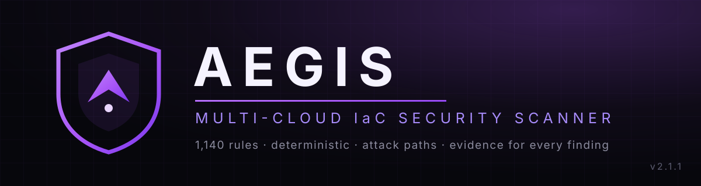

<p align="center">
  
</p>

<p align="center">
  <a href="https://github.com/aeagisenginesec/aegis-engine/releases/tag/v2.1.1"></a>
  <a href="https://github.com/aeagisenginesec/aegis-engine/actions/workflows/ci.yml"></a>
  
  
  
  
</p>

<p align="center">
  <b>Infrastructure-as-Code security scanner — deterministic, evidence-backed,<br>
  and ~148× faster than Trivy on the R4 evaluation sweep.</b>
</p>

Aegis scans Terraform, CloudFormation, ARM, Bicep, Kubernetes manifests,
Dockerfiles, docker-compose, Pulumi YAML and Terraform plan JSON. It builds a
resource relationship graph across your whole estate and reports
misconfigurations with file-and-line evidence — including full **attack paths**
from the internet to your data stores.

---

## Why Aegis

- 🎯 **Measured accuracy, not marketing.** On the frozen R4 ground truth
  (136 adjudicated concepts, 210 projects): **precision 1.000, recall 1.000** —
  the corpus is fully solved. On the *blind* R5 set the honest number is
  recall 0.555, and the gap is published, not hidden (see below).
- ⚡ **Absurdly fast.** The 210-project R4 sweep finishes in **2.2 s**
  (Trivy: 324.9 s). A 1.7M-line fixture yields **1,003,677 findings in ~2 minutes**.
- 🕸️ **Attack paths, not just findings.** `INTERNET → SG(0.0.0.0/0) → EC2 → IAM role → RDS`,
  every hop cited with evidence; `[UNCERTAIN]` markers instead of guesses.
- 🔁 **Deterministic.** Identical input → byte-identical output, every run.
  CI proves it; release gates block on drift.

## Install

**Download a release binary** (v2.1.1 — Linux, macOS, Windows):

| OS | Asset |
|----|-------|
| Linux x86-64 | `aegis-linux-amd64` |
| Linux ARM64 | `aegis-linux-arm64` |
| macOS Intel | `aegis-darwin-amd64` |
| macOS Apple Silicon | `aegis-darwin-arm64` |
| Windows x86-64 | `aegis-windows-amd64.exe` |

Grab them from the [**v2.1.1 release page**](https://github.com/aeagisenginesec/aegis-engine/releases/tag/v2.1.1)
and verify against `SHA256SUMS.txt`:

```bash
# Linux / macOS example
curl -LO https://github.com/aeagisenginesec/aegis-engine/releases/download/v2.1.1/aegis-linux-amd64
chmod +x aegis-linux-amd64
./aegis-linux-amd64 doctor        # aegis 2.1.0 — 1,140 rules loaded
```

**Or build from source** (Go 1.26+):

```bash
go build -o aegis ./cmd/aegis
./aegis doctor
```

## Quick start

```bash
./aegis scan ./my-infra                                   # text report
./aegis scan ./my-infra --format=json --fail-on=high      # CI mode
./aegis scan ./my-infra --attack-paths                    # evidence-backed kill chains
./aegis scan ./my-infra --format=sarif > aegis.sarif      # GitHub code scanning
./aegis fix ./my-infra                                    # safe fixes (dry run by default)
./aegis quality-gate                                      # release gates: precision / recall / perf
```

### What a finding looks like

```text
Aegis 2.1.0 - scan: ./infra
================================================================
  files:     1 discovered, 1 parsed
  resources: 2
  findings:  10  (critical 1, high 4, medium 2, low 3)
================================================================

CRITICAL (1)
----------------------------------------------------------------
  AEGIS-AWS-104  Public S3 exfiltration path
    infra/main.tf:3  aws_s3_bucket.data
    why: An S3 bucket is readable by the public internet through a bucket
         policy granting s3:GetObject to everyone, or a public ACL ...
    evidence: acl = bucket ACL is public-read
    expected: private ACL with public access blocked
    compliance: CIS-AWS-1.5:2.1.1 NIST-800-53:AC-4 PCI-DSS-4.0:1.4.1
    attack path:
      -> internet - anonymous requests from the public internet
      -> aws_s3_bucket.data - bucket ACL grants public read
      -> aws_s3_bucket.data - bucket data is readable under the public ACL
```

Every finding carries the rule ID, exact location, the evidence that fired it,
what was expected instead, compliance mappings, and a remediation path.

## Accuracy — measured, with the receipts

**R4 blind evaluation** (frozen 136-concept ground truth, 210 projects, same
pipeline for every tool):

| Metric | Aegis 2.1.0 | Checkov | KICS | Trivy |
|--------|------------:|--------:|-----:|------:|
| Precision | **1.000** | — | — | 0.469 |
| Recall | **1.000** | — | — | 0.199 |
| F1 | **1.000** | 0.331 | 0.371 | 0.279 |
| Sweep wall time (210 projects) | **2.2 s** | — | — | 324.9 s |

**Scale** (generated fixtures, seeded and reproducible):

| Fixture | Findings | Wall time |
|---------|---------:|----------:|
| vuln-1000 (17,911 lines) | 9,719 | ~0.5 s |
| vuln-10000 (177,760 lines) | 100,926 | ~5.4 s |
| vuln-100000 (1.7M lines) | 1,003,677 | ~2 min |

> **Honesty box — R5 blind set.** On the never-tuned-on R5 corpus, Aegis scores
> recall **0.555** (auto-scored): the misses are a *coverage* frontier —
> hardcoded secrets in template parameter defaults and config files lead the
> list. Raw auto-precision (0.090) did not survive hand re-verification of the
> labels; corrected precision is **0.79–0.92**. One known false-positive family
> (AWS-001 vs S3's SSE-S3 default) is documented in the R5 record. Full data:
> `docs/audit/raw/final-eval-r5/` and `docs/audit/26_AEGIS_FINAL_STATE.md`.

Methodology: [docs/audit/14_TRIVY_OUTPERFORM_REPORT.md](docs/audit/14_TRIVY_OUTPERFORM_REPORT.md) ·
[docs/BENCHMARKS.md](docs/BENCHMARKS.md) · [CHANGELOG.md](CHANGELOG.md)

## Coverage

| Surface | Formats |
|---------|---------|
| **Cloud** | AWS · Azure · GCP · Alibaba Cloud · OCI |
| **Formats** | Terraform / HCL · Terraform plan JSON · CloudFormation · ARM · Bicep · Kubernetes YAML · Dockerfile · docker-compose · Pulumi YAML |
| **Rule packs** | AWS, Azure, GCP, Alibaba, OCI, Kubernetes, Docker, Compose, supply-chain, Terraform-generic, custom YAML rules |
| **Mappings** | CIS AWS 1.5 · NIST 800-53 · PCI DSS 4.0 |

Full per-service inventory: [docs/COVERAGE_MATRIX.md](docs/COVERAGE_MATRIX.md)

## Features

- **1,140 active detection rules**, each with positive/negative regression tests
- **Attack paths** (`--attack-paths`) — cross-resource kill chains with cited evidence
- **Secret taint tracking** — user data, tags, outputs, variable defaults; values redacted in all output
- **Quality gates** (`quality-gate`) — precision/recall/coverage/perf checks that block releases
- **Safe remediation** (`fix`) — dry-run default, minimal diffs, re-parse validation; IAM and security groups never auto-patched without `--force`
- **Suppressions & baselines** — `# aegis:ignore=RULE-ID`, stable baseline files for CI
- **YAML custom rules** — user-defined checks without writing Go
- **SARIF / JSON / text** output; SARIF chunking for GitHub code scanning
- **Completeness auditing** — skipped, oversize and unreadable files are reported, never silently dropped

## Scope — what Aegis is and isn't

Aegis scans **static infrastructure-as-code for misconfigurations**. It does
**not** scan container images, SBOMs, licenses, or live cloud accounts, and it
is **not** a CVE scanner. All benchmark claims are measured on
IaC-misconfiguration workloads only.

Pulumi programs written in TypeScript/JavaScript, Python, Go, .NET, or Java are
**detected but not analyzed** (a static scanner cannot evaluate them without
executing code, which Aegis never does). The scanner emits a warning diagnostic
naming the unparsed program files, so "0 findings" is never misread as "clean".
See [docs/PULUMI.md](docs/PULUMI.md) and [docs/LIMITATIONS.md](docs/LIMITATIONS.md).

## Docs

- [Final state (v2.1.0 closeout)](docs/audit/26_AEGIS_FINAL_STATE.md) — the complete accuracy record
- [Changelog](CHANGELOG.md) — what changed in every release
- [Coverage matrix](docs/COVERAGE_MATRIX.md) — per-service rule inventory
- [Architecture](docs/ARCHITECTURE.md) · [CI integration](docs/CI_INTEGRATION.md) · [Baselines](docs/BASELINES.md)
- [Attack paths](docs/PHASE3_ATTACK_PATHS.md) · [Production hardening](docs/PHASE4_PRODUCTION.md)
- [Final verdict](docs/FINAL_VERDICT.md) — the honest comparison
- Release notes: [v2.0.0](docs/audit/16_RELEASE_NOTES_v2.0.0.md) · [v1.0.0](docs/RELEASE_NOTES_v1.0.0.md)

## Project layout

```
cmd/aegis/            CLI (scan, fix, serve, quality-gate, doctor)
internal/rules/       rule packs: aws, azure, gcp, alibaba, oci, k8s,
                      docker, compose, supplychain, terraform, custom
internal/adapter/     format adapters: terraform, cloudformation, k8s,
                      dockerfile, compose, bicep, arm, pulumi
internal/attackpath/  kill-chain builder with uncertainty handling
internal/qualitygate/ release-blocking precision/recall/perf gates
internal/remediation/ safe auto-fix with IAM/networking blocklist
internal/graph/       resource relationship graph
internal/report/      text / JSON / SARIF renderers (secrets redacted)
benchmark/            held-out corpus generator + raw results
docs/                 coverage matrix, validation, release notes
examples/             sample projects and workflows
```

<p align="center">
  <sub>Built with Go 1.25 · Deterministic by design · Every claim in this README is measured — see <a href="docs/audit/26_AEGIS_FINAL_STATE.md">the audit record</a>.</sub>
</p>
