<p align="center">
  
</p>

<p align="center">
  <a href="https://github.com/aeagisenginesec/aegis-engine/releases/tag/v2.4.0"></a>
  <a href="https://github.com/aeagisenginesec/aegis-engine/actions/workflows/ci.yml"></a>
  
  
  
  
  
</p>

<p align="center">
  <b>Infrastructure-as-Code security scanner — deterministic, evidence-backed,<br>
  and 571× faster than Checkov on the R7 blind evaluation.</b>
</p>

Aegis scans Terraform, CloudFormation, ARM, Bicep, Kubernetes manifests,
Dockerfiles, docker-compose, Pulumi YAML and Terraform plan JSON — a whole
directory or a single file. It builds a resource relationship graph across
your estate and reports misconfigurations with file-and-line evidence —
including full **attack paths** from the internet to your data stores.

**Latest release: v2.4.1** (2026-11-27) — **1,148 active rules**, Go 1.27,
Linux / macOS / Windows binaries plus a GHCR container image. See
[What's new in v2.4.0](#whats-new-in-v240) below.

---

## What's new in v2.4.0

- **SBOM generation (`--sbom`).** `aegis scan --sbom spdx-json|cyclonedx-json`
  writes a dependency inventory alongside the findings report: SPDX 2.3 or
  CycloneDX 1.6. Covers Terraform `required_providers` + module sources
  (with versions where pinned), Dockerfile base images and Compose service
  images — direct references only, no transitive resolution, no registry
  lookups. See [docs/SBOM.md](docs/SBOM.md).
- **IAM negative-logic evaluation.** Statements using `NotAction` /
  `NotResource` are no longer silently skipped. A broad grant such as
  `NotAction: ["iam:DeleteUser"]` on `*` is now treated as the near-admin
  grant it is, with the exclusion carried in the finding's evidence.
- **IAM kill-chain links.** Lambda/EC2 roles with over-broad grants and
  open trust relationships are linked to in-scope data stores —
  evidence-backed, no invented hops — with ordered remediation steps
  (contain → audit → recover → verify).
- **Benchmark-file authority.** Release gates can be driven from a
  benchmark file, so a release cannot ship on stale numbers.
- **SIEM/SOAR webhook (`--webhook`).** POST the JSON report to an HTTPS
  endpoint after a scan. See [docs/WEBHOOK.md](docs/WEBHOOK.md).

Full list: [CHANGELOG.md](CHANGELOG.md).

## Why Aegis

- 🎯 **Measured accuracy, not marketing.** On the fresh blind R7 set
  (151-concept ground truth, 210 *new* projects): **F1 0.925, recall 0.861**
  vs Checkov's 0.530 / 0.361 — leading on all 8 formats and all 4 providers.
- ⚡ **Absurdly fast.** The 210-project R7 sweep runs at **0.010 s median**
  per project (Checkov: 5.92 s). A 1.7M-line fixture yields **1,003,677 findings in ~2 minutes**.
- 🕸️ **Attack paths, not just findings.** `INTERNET → SG(0.0.0.0/0) → EC2 → IAM role → RDS`,
  every hop cited with evidence; `[UNCERTAIN]` markers instead of guesses.
- 🔁 **Deterministic.** Identical input → byte-identical output, every run.
  CI proves it; release gates block on drift.

## Install

**Download a release binary** (v2.4.0 — Linux, macOS, Windows):

| OS | Asset |
|----|-------|
| Linux x86-64 | `aegis-linux-amd64` |
| Linux ARM64 | `aegis-linux-arm64` |
| macOS Intel | `aegis-darwin-amd64` |
| macOS Apple Silicon | `aegis-darwin-arm64` |
| Windows x86-64 | `aegis-windows-amd64.exe` |

Grab them from the [**v2.4.0 release page**](https://github.com/aeagisenginesec/aegis-engine/releases/tag/v2.4.0)
and verify against `SHA256SUMS.txt`:

```bash
# Linux / macOS example
curl -LO https://github.com/aeagisenginesec/aegis-engine/releases/download/v2.4.0/aegis-linux-amd64
chmod +x aegis-linux-amd64
./aegis-linux-amd64 doctor        # aegis 2.4.0 — 1,148 rules loaded
```

**Or run the container image** (published to GHCR on every release):

```bash
docker run --rm -v "$PWD:/src" ghcr.io/aeagisenginesec/aegis-engine:v2.4.0 scan /src
# Podman works the same way: podman run --rm -v "$PWD:/src" ghcr.io/aeagisenginesec/aegis-engine:v2.4.0 scan /src
```

**Or build from source** (Go 1.27+):

```bash
go build -o aegis ./cmd/aegis
./aegis doctor
```

## GitHub Action

Run Aegis in CI as the principal IaC scanner — findings land in GitHub
code scanning as native annotations, and the job fails at the severity
you choose:

```yaml
jobs:
  aegis:
    runs-on: ubuntu-latest
    permissions:
      contents: read
      security-events: write   # for the SARIF upload
    steps:
      - uses: actions/checkout@v4
      - uses: aeagisenginesec/aegis-engine@v2
        with:
          path: ./infra
          fail-on: high        # critical | high | medium | low | none
```

| Input | Default | Meaning |
|-------|---------|---------|
| `path` | `.` | Directory to scan |
| `version` | `v2.4.0` | Aegis release to run (downloaded and SHA-256 verified) |
| `fail-on` | `high` | Lowest severity that fails the job |
| `baseline` | — | Baseline file from a previous `--baseline-out` run |
| `upload-sarif` | `true` | Upload SARIF to code scanning |
| `args` | — | Extra arguments passed verbatim to `aegis scan` |

Outputs: `sarif-file` (absolute path of the SARIF report) and `findings`
(total findings after baseline suppression). The Action downloads the
pinned Aegis release, verifies its SHA-256 against the published
`SHA256SUMS.txt`, scans, and uploads SARIF. Baselines (`--baseline-out`
once, commit the file, pass `baseline: aegis-baseline.json`) suppress known
debt so the gate only fires on new findings. Full guide, inputs and the
phased shadow → gate → cutover adoption path:
[docs/github-actions.md](docs/github-actions.md).

## Quick start

```bash
./aegis scan ./my-infra                                   # text report
./aegis scan main.tf                                      # a single file also works
./aegis scan ./my-infra --format=json --fail-on=high      # CI mode
./aegis scan ./my-infra --attack-paths                    # evidence-backed kill chains
./aegis scan ./my-infra --format=sarif > aegis.sarif      # GitHub code scanning
./aegis scan ./my-infra --format=html > report.html        # standalone attestation report
./aegis scan ./my-infra --compliance=all                  # posture per framework
./aegis scan ./my-infra --sbom spdx-json                # SPDX 2.3 dependency inventory (see docs/SBOM.md)
./aegis scan ./my-infra --webhook https://siem.example.com/hook  # POST the JSON report to SIEM/SOAR (see docs/WEBHOOK.md)
./aegis fix ./my-infra                                    # safe fixes (dry run by default)
./aegis serve                                             # HTTP API on 127.0.0.1:8734
./aegis quality-gate                                      # release gates: precision / recall / perf
./aegis doctor                                            # self-check: version, 1,148 rules, smoke tests
```

`aegis serve` exposes `POST /v1/scan` (scan files sent as JSON) and
`GET /v1/health`, binds loopback by default, and takes a Bearer token
(`--auth-token`, or `AEGIS_SERVE_TOKEN`) — required in practice whenever
it binds a non-loopback address.

### What a finding looks like

```text
Aegis 2.4.0 - scan: ./infra
================================================================
  files:     1 discovered, 1 parsed
  resources: 2
  findings:  10  (critical 1, high 4, medium 2, low 3)
================================================================

CRITICAL (1)
----------------------------------------------------------------
  AEGIS-AWS-104  Public S3 exfiltration path
    infra/main.tf:3  aws_s3_bucket.data
    why: An S3 bucket is readable by the public internet through a bucket
         policy granting s3:GetObject to everyone, or a public ACL ...
    evidence: acl = bucket ACL is public-read
    expected: private ACL with public access blocked
    compliance: CIS-AWS-1.5:2.1.1 NIST-800-53:AC-4 PCI-DSS-4.0:1.4.1
    attack path:
      -> internet - anonymous requests from the public internet
      -> aws_s3_bucket.data - bucket ACL grants public read
      -> aws_s3_bucket.data - bucket data is readable under the public ACL
```

Every finding carries the rule ID, exact location, the evidence that fired it,
what was expected instead, compliance mappings, and a remediation path.

## Accuracy — measured, with the receipts

**R7 blind evaluation** (v2.4.0, frozen 151-concept ground truth, 210 *new*
projects, same pipeline for every tool — the gain from the R6 gap fixes
held on fresh code, not just the tuned corpus):

| Metric | Aegis 2.4.0 | Checkov |
|--------|------------:|--------:|
| F1 | **0.925** | 0.530 |
| Recall | **0.861** | 0.361 |
| True positives | **125** | 45 |
| False positives | 0 | 0 |
| Median scan time | **0.010 s** | 5.92 s |

Aegis leads on all 8 formats and all 4 providers. Honest verdict: **not yet
a clean win** — the false-positive criterion fails on a genuine 0–0 tie
(both scanners factually perfect on 2,355 adjudicated findings), so it can
only be settled on a corpus where Checkov slips and Aegis does not. Full
data: [docs/audit/32_FINAL_EVAL_R7_REPORT.md](docs/audit/32_FINAL_EVAL_R7_REPORT.md).

**Scale** (generated fixtures, seeded and reproducible):

| Fixture | Findings | Wall time |
|---------|---------:|----------:|
| vuln-1000 (17,911 lines) | 9,719 | ~0.5 s |
| vuln-10000 (177,760 lines) | 100,926 | ~5.4 s |
| vuln-100000 (1.7M lines) | 1,003,677 | ~2 min |

Methodology: [R7 evaluation protocol](docs/audit/31_EVAL_R7_PROTOCOL.md) ·
[docs/BENCHMARKS.md](docs/BENCHMARKS.md) · [CHANGELOG.md](CHANGELOG.md)

## Coverage

| Surface | Formats |
|---------|---------|
| **Cloud** | AWS · Azure · GCP · Alibaba Cloud · OCI |
| **Formats** | Terraform / HCL · Terraform plan JSON · CloudFormation · ARM · Bicep · Kubernetes YAML · Dockerfile · docker-compose · Pulumi YAML |
| **Rule packs** | AWS, Azure, GCP, Alibaba, OCI, Kubernetes, Docker, Compose, supply-chain, Terraform-generic, custom YAML rules |
| **Mappings** | CIS AWS 1.5 · CIS Azure 2.1 · CIS GCP 1.3 · CIS Kubernetes 1.8 · CIS Docker 1.6 · NIST 800-53 · PCI DSS 4.0 · ISO 27001 · SOC 2 · HIPAA |

**1,148 active detection rules** across those packs. Full per-service
inventory: [docs/COVERAGE_MATRIX.md](docs/COVERAGE_MATRIX.md)

## Features

- **1,148 active detection rules**, each with positive/negative regression tests
- **Attack paths** (`--attack-paths`) — cross-resource kill chains with cited evidence
- **IAM kill-chain links** — Lambda/EC2 roles with over-broad grants and open
  trust relationships linked to in-scope data stores, evidence-backed, no invented hops
- **IAM negative-logic evaluation** — `NotAction` / `NotResource` statements are
  evaluated with real policy semantics instead of silently skipped
- **Secret taint tracking** — user data, tags, outputs, variable defaults; values redacted in all output
- **Quality gates** (`quality-gate`) — precision/recall/coverage/perf checks that block releases
- **Safe remediation** (`fix`) — dry-run default, minimal diffs, re-parse validation; IAM and security groups never auto-patched without `--force`; attack-path findings get ordered SOC steps (contain → audit → recover → verify)
- **Suppressions & baselines** — `# aegis:ignore=RULE-ID`, stable baseline files for CI, expiring waivers (`--waiver-reason/--waiver-owner/--waiver-expires`)
- **YAML custom rules** — user-defined checks without writing Go (`--custom-rules`)
- **SARIF / JSON / text / HTML** output; SARIF chunking for GitHub code scanning, stable fingerprints and compliance tags per result
- **SIEM/SOAR webhook** (`--webhook`) — POST the JSON report to an HTTPS endpoint after a scan; see [docs/WEBHOOK.md](docs/WEBHOOK.md)
- **SBOM generation** (`--sbom spdx-json|cyclonedx-json`) — SPDX 2.3 /
  CycloneDX 1.6 dependency inventory of the scanned project
  (providers, modules, base images); see [docs/SBOM.md](docs/SBOM.md)
- **HTTP API** (`serve`) — `POST /v1/scan`, `GET /v1/health`, loopback by
  default, Bearer-token auth for non-loopback binds
- **Compliance posture** (`--compliance`) — per-control pass/fail for one
  framework or `all` (10 frameworks), plus a standalone HTML attestation
  report with `--format=html`
- **Completeness auditing** — skipped, oversize and unreadable files are reported, never silently dropped
- **Project config** — `aegis.yaml` with severity overrides and excluded
  rules; `--exclude` globs, `--strict` parse-failure mode, `--timeout` and
  `--max-file-size` (10 MB default) guards

## What's next

- **R8 fresh blind evaluation** — a new 210-project corpus to confirm the
  v2.4.0 gains on fresh code and settle the false-positive question where
  Checkov slips and Aegis does not.
- **Closing the last gaps** — the 17 findings Aegis still misses on R7, led
  by hard-coded secrets in Bicep parameter files and public RDS snapshots.
- **ARM & Bicep depth** — the two formats where Checkov still leads, now the
  focus of the next rule batch.

## Docs

- [Evaluation record](docs/audit/32_FINAL_EVAL_R7_REPORT.md) — R7 blind eval (v2.4.0) · [R6 blind eval](docs/audit/28_FINAL_EVAL_R6_REPORT.md) · [final state (v2.1.0 closeout, historical)](docs/audit/26_AEGIS_FINAL_STATE.md)
- [Changelog](CHANGELOG.md) — what changed in every release
- [Coverage matrix](docs/COVERAGE_MATRIX.md) — per-service rule inventory
- [Architecture](docs/ARCHITECTURE.md) · [CI integration](docs/CI_INTEGRATION.md) · [Baselines](docs/BASELINES.md)
- [Compliance & waivers](docs/compliance.md) — framework mappings, posture reporting, HTML attestation, expiring waivers
- [SIEM/SOAR webhook](docs/WEBHOOK.md) — push scan results to an HTTPS endpoint after a scan
- [SBOM generation](docs/SBOM.md) — SPDX 2.3 / CycloneDX 1.6 dependency inventory of the scanned project
- [Attack paths](docs/PHASE3_ATTACK_PATHS.md) · [Production hardening](docs/PHASE4_PRODUCTION.md)
- [Final verdict](docs/FINAL_VERDICT.md) — the honest comparison
- [Checkov comparison](docs/CHECKOV_COMPARISON.md) — head-to-head detail
- Release notes: [v2.4.0](https://github.com/aeagisenginesec/aegis-engine/releases/tag/v2.4.0) · [v2.0.0](docs/audit/16_RELEASE_NOTES_v2.0.0.md) · [v1.0.0](docs/RELEASE_NOTES_v1.0.0.md)

## Project layout

```
cmd/aegis/            CLI (scan, fix, serve, quality-gate, doctor)
internal/rules/       rule packs: aws, azure, gcp, alibaba, oci, k8s,
                      docker, compose, supplychain, terraform, custom
internal/adapter/     format adapters: terraform, cloudformation, k8s,
                      dockerfile, compose, bicep, arm, pulumi
internal/attackpath/  kill-chain builder with uncertainty handling
internal/qualitygate/ release-blocking precision/recall/perf gates
internal/remediation/ safe auto-fix with IAM/networking blocklist
internal/graph/       resource relationship graph
internal/report/      text / JSON / SARIF / HTML renderers (secrets redacted)
internal/webhook/     SIEM/SOAR webhook delivery (HTTPS, Bearer, bounded retry)
internal/sbom/        SBOM generation (SPDX 2.3 / CycloneDX 1.6)
benchmark/            held-out corpus generator + raw results
docs/                 coverage matrix, validation, release notes
examples/             sample projects and workflows
```

<p align="center">
  <sub>Built with Go 1.27 · Deterministic by design · Every claim in this README is measured — see <a href="docs/audit/32_FINAL_EVAL_R7_REPORT.md">the audit record</a>.</sub>
</p>
